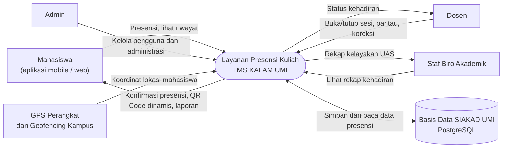
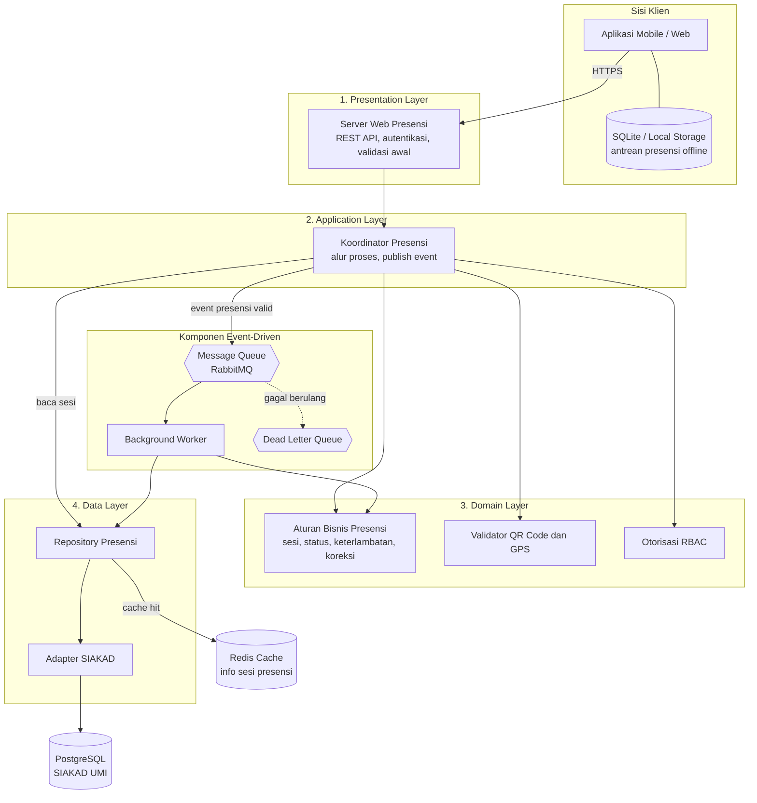
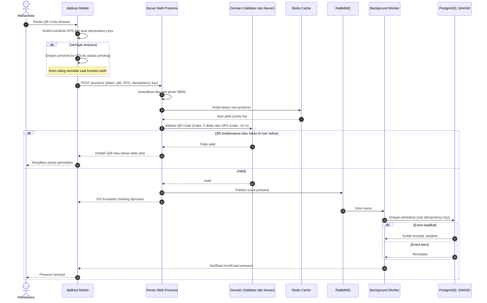
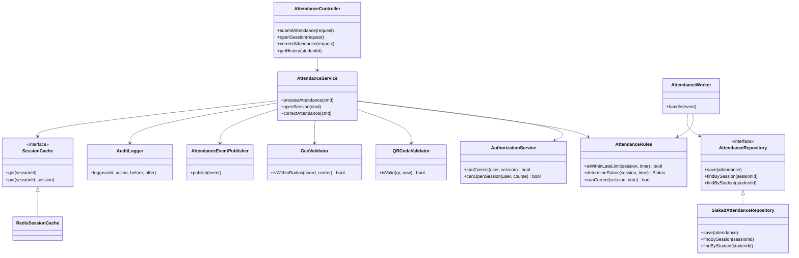

# U5. Desain dan Diagram

## 1. Pendahuluan

Bagian ini menerjemahkan konteks dan ASR (U1), skenario atribut kualitas (U2), taktik (U3), serta pola arsitektur (U4) menjadi rancangan visual layanan Presensi Kuliah LMS KALAM UMI. Bagian ini berisi empat diagram, masing-masing dengan keterangan, dan tiga prinsip desain yang diterapkan.

| No. | Diagram | Jenis | Tujuan |
|---|---|---|---|
| 1 | Diagram Konteks | Konteks | Menunjukkan batas sistem, pengguna, dan sistem eksternal. |
| 2 | Diagram Arsitektur | Arsitektur yang menerapkan pola | Menunjukkan penerapan Layered Architecture dan Event-Driven Architecture. |
| 3 | Sequence Diagram | UML | Menunjukkan alur presensi mahasiswa dari permintaan hingga data tersimpan. |
| 4 | Class Diagram | UML | Menunjukkan struktur kelas utama dan penerapan prinsip desain. |

---

## 2. Diagram

### 2.1 Diagram 1: Diagram Konteks

**Keterangan:**

| Elemen | Peran |
|---|---|
| Mahasiswa | Melakukan presensi dengan memindai QR Code dinamis dan mengirim koordinat GPS, serta melihat riwayat kehadiran sendiri. |
| Dosen | Membuka dan menutup sesi, memantau kehadiran, dan mengoreksi presensi pada kelas yang diampu (maksimal 7 hari setelah jadwal kuliah). |
| Staf Biro Akademik | Memakai data rekap kehadiran untuk pemeriksaan persyaratan UAS. |
| Admin | Mengelola data pengguna dan administrasi presensi sesuai kewenangan (RBAC). |
| Layanan Presensi Kuliah | Sistem yang dirancang. Ia memvalidasi, memproses, dan merekap presensi. |
| Basis Data SIAKAD UMI | Basis data PostgreSQL yang sudah tersedia di kampus (batasan teknologi U1). Sistem terhubung dengannya melalui lapisan adapter. |
| GPS Perangkat dan Geofencing | Sumber koordinat untuk validasi radius maksimal 15 meter dari titik tengah gedung perkuliahan. |

Diagram ini menegaskan bahwa layanan presensi **tidak menambah server basis data baru**. Seluruh data kehadiran tetap bermuara ke SIAKAD UMI sesuai batasan anggaran pada U1.

---

### 2.2 Diagram 2: Diagram Arsitektur (Penerapan Layered dan Event-Driven)

**Keterangan:**

| Elemen | Pola | Taktik terkait (U3) | Fungsi |
|---|---|---|---|
| Presentation, Application, Domain, Data Layer | Layered | Increase Cohesion, Reduce Coupling | Setiap lapisan hanya berkomunikasi dengan lapisan di dekatnya. Lapisan tampilan tidak mengakses basis data secara langsung. |
| Aturan Bisnis Presensi | Layered | Encapsulate | Batas keterlambatan dan ketentuan koreksi hanya ada di satu modul. |
| Validator QR Code dan GPS, Otorisasi RBAC | Layered | Validate Input, Authorize Users, Detect Attacks | Menolak QR Code kedaluwarsa (maks. 5 detik) dan lokasi di luar radius 15 meter sebelum data disimpan. |
| RabbitMQ dan Background Worker | Event-Driven | Manage Request, Increase Resource Efficiency | Menampung lonjakan hingga 3.000 permintaan dan memprosesnya bertahap sehingga basis data tidak terbebani. |
| Dead Letter Queue | Event-Driven | Recover | Menyimpan event yang gagal diproses berulang kali agar tidak hilang (kelemahan Event-Driven pada U4). |
| Redis Cache | Pendukung | Maintain Multiple Copies of Data | Menyimpan informasi sesi presensi sehingga pembacaan berulang tidak sampai ke PostgreSQL. |
| SQLite / Local Storage | Pendukung | Maintain Data at Client, Retry | Menyimpan presensi sementara saat jaringan terputus, lalu mengirim ulang otomatis. |
| Adapter SIAKAD | Layered | Reduce Coupling | Satu-satunya titik yang mengenal skema SIAKAD sehingga perubahan di SIAKAD tidak merambat ke modul lain. |

Diagram ini menjawab kelemahan Layered Architecture pada U4, yaitu lapisan saja tidak menyelesaikan lonjakan akses. Penyelesaiannya ada pada jalur event (RabbitMQ dan Worker) yang diletakkan di antara Application Layer dan Data Layer.

---

### 2.3 Diagram 3: UML Sequence Diagram (Proses Presensi Mahasiswa)

**Keterangan:**

- **Langkah 2-4:** aplikasi menyimpan data ke SQLite saat offline dan melampirkan *idempotency key* agar pengiriman ulang tidak menggandakan data (ASR 3, taktik Prevent Duplicate Processing).
- **Langkah 6-8:** informasi sesi dibaca dari Redis dan bukan dari basis data (ASR 1).
- **Langkah 9-10:** validasi QR Code dan GPS dilakukan **sebelum** event dimasukkan ke antrean sehingga permintaan curang tidak membebani antrean maupun basis data (ASR 2).
- **Langkah 11-13:** server membalas cepat dengan status *accepted*, lalu hasil akhir dikirim sebagai notifikasi setelah Worker selesai. Rancangan ini menjaga waktu tanggap di bawah 2 detik. Konsekuensinya, konfirmasi akhir bergantung pada panjang antrean (kekurangan Event-Driven pada U4).

---

### 2.4 Diagram 4: UML Class Diagram

**Keterangan:**

| Kelas | Lapisan | Tanggung jawab |
|---|---|---|
| AttendanceController | Presentation | Menerima permintaan HTTP dan meneruskannya ke service tanpa logika bisnis. |
| AttendanceService | Application | Mengoordinasikan autentikasi, validasi, publish event, dan pencatatan audit. |
| AuthorizationService | Domain | Menerapkan RBAC (mahasiswa, dosen, admin). |
| AttendanceRules | Domain | Menyimpan aturan bisnis yang sering berubah (batas keterlambatan, batas koreksi 7 hari). |
| QRCodeValidator, GeoValidator | Domain | Memvalidasi masa berlaku QR Code dan radius lokasi. |
| AttendanceEventPublisher, AttendanceWorker | Application / Event-Driven | Mengirim event ke RabbitMQ dan memprosesnya secara asinkron. |
| AuditLogger | Application | Mencatat setiap perubahan presensi agar dapat ditelusuri (kebutuhan profesional U1). |
| AttendanceRepository (interface) dan SiakadAttendanceRepository | Data | Interface dipakai oleh lapisan atas. Implementasi PostgreSQL SIAKAD tersembunyi di balik adapter. |
| SessionCache (interface) dan RedisSessionCache | Data | Abstraksi cache sehingga Redis dapat diganti tanpa mengubah service. |

---

## 3. Prinsip Desain yang Diterapkan

### 3.1 Separation of Concerns (Pemisahan Tanggung Jawab)

**Isi prinsip:** setiap bagian sistem menangani satu aspek perhatian yang berbeda.

**Penerapan:** sistem dibagi menjadi empat lapisan (Presentation, Application, Domain, Data) dan komponen event (RabbitMQ dan Worker) dipisah dari jalur permintaan. Penerimaan permintaan, validasi, aturan bisnis, dan penyimpanan tidak bercampur (Diagram 2).

**Manfaat:** mendukung skenario Maintainability karena perubahan aturan bisnis cukup dilakukan di Domain Layer (maksimal 1 modul). Pemisahan jalur event juga memungkinkan lonjakan permintaan ditangani tanpa mengubah aturan bisnis.

### 3.2 Single Responsibility Principle (Tanggung Jawab Tunggal)

**Isi prinsip:** satu kelas atau modul hanya memiliki satu alasan untuk berubah.

**Penerapan:** pada Diagram 4, `QRCodeValidator` hanya mengurus QR Code dan `GeoValidator` hanya mengurus lokasi. `AttendanceRules` hanya memuat aturan akademik, sedangkan `AuditLogger` hanya mencatat aktivitas. Perubahan masa berlaku QR Code tidak menyentuh aturan keterlambatan, dan sebaliknya.

**Manfaat:** kelas kecil dan terfokus lebih mudah diuji secara terpisah (target code coverage minimal 80%) dan lebih cepat dipahami pengembang baru (target di bawah 4 jam kerja).

### 3.3 Dependency Inversion Principle (Pembalikan Ketergantungan)

**Isi prinsip:** modul tingkat tinggi bergantung pada abstraksi (interface), bukan pada implementasi konkret.

**Penerapan:** `AttendanceService` dan `AttendanceWorker` bergantung pada interface `AttendanceRepository` dan `SessionCache`. Detail PostgreSQL SIAKAD dan Redis berada di `SiakadAttendanceRepository` dan `RedisSessionCache` (Diagram 4). Hal ini sesuai implikasi U1 bahwa integrasi dengan SIAKAD dilakukan melalui lapisan adapter.

**Manfaat:** perubahan skema SIAKAD atau penggantian teknologi cache hanya memengaruhi adapter. Layanan presensi juga dapat diuji dengan repository tiruan (*mock*) tanpa basis data nyata, sehingga tidak mengganggu sistem akademik yang sedang berjalan.

### 3.4 Ringkasan Prinsip Desain

| Prinsip | Diterapkan pada | ASR / Skenario yang didukung |
|---|---|---|
| Separation of Concerns | Empat lapisan dan jalur event terpisah | Maintainability, Performance |
| Single Responsibility | Validator, Rules, AuditLogger terpisah | Maintainability, Security |
| Dependency Inversion | Interface Repository dan Cache dengan adapter | Maintainability, integrasi SIAKAD |

---

## 4. Keterkaitan Diagram dengan ASR dan Taktik

| ASR / Skenario | Diagram yang menunjukkan | Mekanisme utama |
|---|---|---|
| ASR 1 / Performance | Diagram 2, Diagram 3 | Redis Cache, RabbitMQ, Background Worker, respons 202 Accepted |
| ASR 2 / Security | Diagram 2, Diagram 3, Diagram 4 | RBAC, validasi QR Code dan GPS sebelum antrean, AuditLogger |
| ASR 3 / Resilience | Diagram 2, Diagram 3 | SQLite lokal, retry, idempotency key |
| Maintainability | Diagram 2, Diagram 4 | Empat lapisan, AttendanceRules terenkapsulasi, interface dan adapter |

## 5. Kesimpulan

Empat diagram pada U5 menunjukkan batas sistem (Diagram 1), penerapan Layered dan Event-Driven Architecture (Diagram 2), alur presensi dari klien hingga basis data (Diagram 3), dan struktur kelas yang memenuhi prinsip desain (Diagram 4). Prinsip Separation of Concerns, Single Responsibility, dan Dependency Inversion memastikan rancangan tetap mudah dipelihara serta konsisten dengan taktik pada U3 dan pola pada U4.

Rancangan ini menjadi dasar evaluasi pada U6 (pohon utilitas, analisis trade-off, dan ATAM) dan pencatatan keputusan pada U7 (ADR), misalnya keputusan memakai respons asinkron *202 Accepted* dan keputusan memakai adapter SIAKAD.

